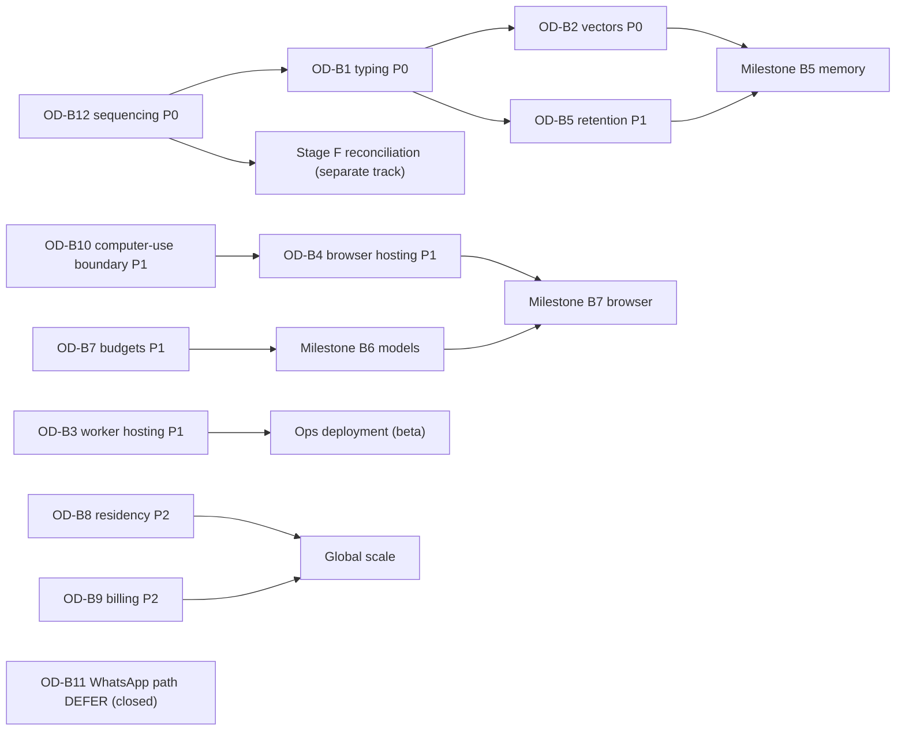

# DEXYBOR AI — OD-B1…OD-B12 OWNER DECISION MATRIX (TECHNICAL REVIEW)

**Report:** PB-ODM-1 · **Date:** 2026-11-07
**Repo:** `C:\Users\ys725\OneDrive\Documents\Default Project\nexa` — DEXYBOR AI (legacy: Nexa) · HEAD `8c70be6` (`codex/appointment-integration-v1`, in sync)
**Reviewed document:** `docs/DEXYBOR_PHASE_B_ARCHITECTURE_BLUEPRINT.md` (read in full; SHA-256 at review `C0FC8B066735574D927A015572CCCC13E4585C134A417D7B2DF3D25E489D3EBA`) + existing repo evidence used where needed (MH-I fresh matrix, `package.json`, module globs, `lib/ai/provider.ts`).

> ## REVIEW ARTIFACT — NOT AUTHORIZATION
> This matrix is a **technical evaluation and decision-preparation artifact**. Every recommendation below is an **architecture recommendation, not owner approval**. All owner decision fields are **blank**; the preparing operator generates no approvals, signatures, initials, or dates. Completion of any OD-B decision does **not** authorize Stage F, does **not** authorize Phase B implementation, and does **not** modify the standing hold: `STAGE F BLOCKED — OWNER AUTHORIZATION MISSING`.

---

## 1. Scope, method, and classification integrity (§2)

- Read the complete blueprint (§1–§14 incl. roadmap B1–B9, threat model §9, decision register §12).
- Re-checked repository evidence for every "existing" claim used in the review: verified-existing set = Supabase SSR auth + `proxy.ts` middleware, creator-owned workspace RLS + least-privilege allow-lists, audit events + webhook ledger, WhatsApp in/out triple-gated pipeline (`WHATSAPP_OUTBOUND_ENABLED=false` everywhere), conversation kill switch/human takeover/opt-out, bounded mock-provider AI (`AI_PROVIDER=mock` default; openAI adapter offline, unkeyed), Google Calendar staging gate + sandbox booking provider abstraction, review queues + origin/route guards, production guard chain, 667-test suite.
- Classification rule preserved throughout: **existing-verified** facts carry test evidence; **partially implemented** marks real-but-bounded precursors; everything else in the design is **PROPOSED FOR PHASE B**; unimplemented capabilities remain **NOT IMPLEMENTED**. No proposed functionality is described as existing anywhere in this matrix.

## 2. Summary decision table (§7)

| ID | Decision (blueprint §12, verbatim title) | Priority | Technical recommendation | Owner status |
|---|---|---|---|---|
| OD-B1 | Prompt/agent library (e.g., a schema lib) allowed or zero-new-deps contract typing | **P0** | Zero-new-deps typed contracts + one small internal validator util (Option C) | `PENDING OWNER DECISION` |
| OD-B2 | pgvector vs no-embeddings-for-now | **P0** | No embeddings now; migration-ready schema design; revisit with evidence (Option A + readiness clause) | `PENDING OWNER DECISION` |
| OD-B3 | Worker process hosting model (own process vs serverless/cron) | **P1** | Dedicated stateless Node worker process; hosting swap isolated behind queue interface (Option A) | `PENDING OWNER DECISION` |
| OD-B4 | Playwright runtime browsers + browser service hosting (local/CI/container) | **P1** | Staged: worker-host install (closed testing) → containerized service before real-tenant use (Option A→B) | `PENDING OWNER DECISION` |
| OD-B5 | Retention windows per memory layer + event archive policy | **P1** | Adopt proposed draft defaults, **after legal/privacy review**; values remain owner-editable config (Option A with review gate) | `PENDING OWNER DECISION` |
| OD-B6 | Model provider activation order + keys/procurement (none active; mock default) | **P1** | Staged progression via the six-stage ownership ladder; no foundation-model training (Section 6) | `PENDING OWNER DECISION` |
| OD-B7 | Budget defaults (per task/workspace ceiling values) | **P1** | Hard ceilings from B6 onward with conservative provisional values; owner-adjustable policy rows | `PENDING OWNER DECISION` |
| OD-B8 | Residency topology / tenant→region policy (deferred) | **P2** | Keep deployment deferred; carry cheap `region_code` field + policy hooks now (Option A+field) | `PENDING OWNER DECISION` |
| OD-B9 | Billing integration boundary (none in Phase B) | **P2** | Metering-only in Phase B; no external billing integration; revisit at commercialization (Option A) | `PENDING OWNER DECISION` |
| OD-B10 | Computer-use deferral confirmation (stay deferred) | **P1** | Explicitly confirm deferral; B7 = browser only; revisit needs separate authorization (Option A) | `PENDING OWNER DECISION` |
| OD-B11 | Any agent→WhatsApp send pathway (Tier-5; separate authorization, additive, post-existing-gates) | **DEFER** | Keep the pathway CLOSED through all of Phase B; revisit only by formal request + separate written approval | `PENDING OWNER DECISION` |
| OD-B12 | Phase B workstream sequencing vs Stage F (parallel-token or after Stage F) | **P0** | Phase B implementation AFTER Stage F reconciliation (MH-D S1 base), never parallel to it | `PENDING OWNER DECISION` |

**Priority counts: P0 = 3 · P1 = 6 · P2 = 2 · DEFER = 1** (total 12; no decision blanket-blocks everything — each P0 gates only the milestone it names).

---

## 3. Decision dependency analysis (§5)

### 3.1 Dependency map

| Dependency rule | Decisions |
|---|---|
| Must be resolved **before B1** (any Phase B repo work) | **OD-B12** (sequencing/authorization gate — root decision) |
| Recommended before B1; **hard-required by B2** | **OD-B1** (contract typing/validator approach feeds every runtime module thereafter) |
| Required **before B5** | **OD-B2** (M4 retrieval design; an explicit "no embeddings now" answer is a valid owner decision that unblocks B5) and **OD-B5** (retention/privacy semantics are baked into memory-table design) |
| Required **before B6-era enforcement** | **OD-B7** (ceiling existence is B6 design; values even provisional) |
| Required **before any provider activation** | **OD-B6** (and it re-consults OD-B7 budgets + OD-B5 context-sharing policy) |
| Required **before B7 scope freeze** | **OD-B10** (confirms browser-only boundary) → **OD-B4** (browser hosting enables T4) |
| Required **before B1/ops deployment** (not for local build) | **OD-B3** (worker hosting shape) |
| Required **before global scale** | **OD-B8** (residency), **OD-B9** (billing boundary) |
| Required **only if ever requested** | **OD-B11** (WhatsApp pathway — default closed; DEFER) |

Mermaid sketch of the gating order (arrows = "feeds into"):



### 3.2 Circular dependencies and resolution order

No hard circular dependency exists. Two **soft cycles** are identified with the proposed resolutions:

1. **OD-B6 ↔ OD-B7:** informed budget defaults want provider pricing; provider activation wants budget protection. **Resolution:** provisional conservative ceilings (OD-B7, Option A) bind from B6 onward; values are revised once a real provider's metered costs are observed — protection never lags activation.
2. **OD-B3 ↔ OD-B4:** worker and browser-service hosting are one operational family. **Resolution:** decide them jointly in one sitting (OD-B3 first by priority, OD-B4 immediately after) rather than sequentially in isolation.

**Recommended resolution order for owner sessions:** `OD-B12 → OD-B1 → OD-B2 → OD-B5 → OD-B10 → OD-B7 → OD-B6 → OD-B3 → OD-B4 → OD-B8 → OD-B9 → OD-B11`.

### 3.3 Governance-linked dependencies (§5 final rows)

| Category | Decisions |
|---|---|
| Block security acceptance (of the relevant milestone) | OD-B1 (tool-arg validation), OD-B5 (retention/deletion + privacy), OD-B7 (runaway-spend control), OD-B10 (prevents capability-creep boundary erosion), OD-B11 (keeps the highest-impact external surface closed) |
| Block global deployment | OD-B8, OD-B9 (+ at ops scale: OD-B3, OD-B4) |
| Require **separate legal / privacy / financial** review | OD-B5 (privacy & retention), OD-B8 (data-residency law), OD-B9 (financial), OD-B11 (messaging compliance & Meta policy), OD-B6 (procurement & data-processing terms) |
| Can remain **runtime-configurable** (existence decided, values adjustable) | OD-B6 routing-table entries, OD-B7 ceiling values, OD-B5 retention values (post-review), OD-B4 domain allow-lists |

---

## 4. Prioritization rationale (§6)

Priorities use the mandated semantics — **P0** = required before the relevant implementation; **P1** = required before a controlled beta; **P2** = required before global scale; **DEFER** = not necessary yet. Rationale per decision appears in its evaluation (field 14-style note below each); the counts are P0=3 / P1=6 / P2=2 / DEFER=1 so that nothing outside B1/B2/B5 gets treated as an immediate blocker.

---

## 5. AI infrastructure ownership progression (§4 evaluation standard)

| Stage (mandated ladder) | Current state (verified) | Entry gate (design) | Owner gate | Recommendation |
|---|---|---|---|---|
| 1. Existing external models | none active; `openAIProvider` present but **offline** (no key); `mock` default deterministic | adapter exists (B6 contract) | key procurement + budget + provider terms | proceed only as stage 2 activation |
| 2. Provider-independent model gateway | design-only (PB-BLU-1 §F) | B1–B2 foundations + OD-B7 ceilings | OD-B6 order + OD-B1/B12 prerequisites | recommended next stage after B2 |
| 3. Open-weight model evaluation | not implemented | gateway live + eval harness (B8) + hosting capacity decision | separate decision with cost/benefit evidence | evaluate after beta evidence; not before |
| 4. Controlled self-hosted inference | not implemented | stage-3 evidence + ops capacity (OD-B3 family) | infra + security review | only with demonstrated need |
| 5. Specialized internal models | not implemented | task-class data asset evidence + evaluation suite | business case | not near-term |
| 6. Foundation-model development | not implemented; DEXYBOR is designed as **not owning a foundation model** | economic + technical justification evidence | a distinct corporate decision far beyond OD-B scope | **explicitly not recommended prematurely** — requires demonstrated scale, cost, latency, compliance, and proprietary-data advantages before any consideration |

---

## 6. Decision-by-decision evaluation (OD-B1 … OD-B12, verbatim registry rows from blueprint §12)

> Each decision below carries the mandated 13 fields, then a **blank owner decision block**. Owners complete only the block; operators never pre-fill it.

### OD-B1 — Prompt/agent library (e.g., a schema lib) allowed or zero-new-deps contract typing · B2 · affects dependency authorization — **P0**

| # | Field | Evaluation |
|---|---|---|
| 1 | Problem being decided | May Phase B add a runtime schema-validation library (zod-family), or must tool/I-O contracts stay zero-new-dependency typed (current house style: plain TS interfaces + contract tests, e.g. `lib/ai/provider.ts`, schema-contract tests)? |
| 2 | Why the decision matters | Every tool manifest input/output in B2 must be strictly validated (threat #3, tool abuse); this choice sets the dependency policy against a repo currently carrying 19 open audit findings, shapes validation completeness, and touches every later subsystem. |
| 3 | Available technical options | **A)** Zero-new-deps typed contracts + per-tool hand-rolled runtime checks · **B)** Add a runtime schema library via an MH-E-style authorized dependency cycle · **C)** Typed contracts + one small internal central validator util (house discipline formalized; library adoption postponed) |
| 4 | Recommended option | **C** — strictly zero new dependencies while the repo's dependency state is 2-critical/5-high; a single central validator keeps the enforcement point uniform; B stays available for a future separately-authorized cycle if evidence demands it. |
| 5 | Advantages (C) | No supply-chain growth during an open-audit period; matches verified repo discipline; offline-testable; one choke point to fuzz. |
| 6 | Disadvantages / trade-offs (C) | Custom validator = human-error surface; slower edge-case coverage than a mature library; marginally more custom code. |
| 7 | Security implications | Validation quality is the first wall against tool abuse and injection-into-tools; mitigated by a mandatory adversarial fuzz corpus regardless of mechanism; centralization enables uniform strictness and auditable rejections. |
| 8 | Scalability implications | Neutral to scale boundaries; C keeps the dependency graph small and semver surface low. |
| 9 | Cost / operational implications | C: no procurement, modest maintenance. B: ~1 dependency now + future upgrade/lockfile churn requiring MD-E-style re-authorization each time. |
| 10 | Dependencies on other decisions | Root-informed by **OD-B12** (when any repo work happens); independent of storage/deployment choices; if B is chosen later it re-opens an MH-E dependency cycle. |
| 11 | Reversibility / migration impact | C→B later is an additive refactor confined to the central validator + declarative layer if the choke point is honored; A→B same with more per-tool edits. Migration is low-impact by construction. |
| 12 | Acceptance criteria | Registry rejects unknown fields, oversized strings, and mistyped args across a complete fuzz corpus; zero new dependencies added without separate authorization; `npm run check` green. |
| 13 | Required owner approval | **Yes — OD-B1 row explicitly.** Option B additionally requires the MH-E-style dependency analysis + authorization + lockfile diff review at that time. |

**Priority rationale:** P0 — B2 (tool registry) cannot be designed without knowing the validation mechanism, and retrofitting validation into a shipped registry is a security-risk refactor.

```text
OWNER DECISION — OD-B1 (leave blank beyond this box; operator must not fill)
[ ] Approve recommendation (Option C)   [ ] Reject recommendation
[ ] Request changes (describe): ______________________________
[ ] Defer until: ______________
Owner rationale: ______________________________________________
Owner initials: ________    Decision date: ______ / ______ / ________
```

### OD-B2 — pgvector vs no-embeddings-for-now · B5 · storage/migration append — **P0**

| # | Field | Evaluation |
|---|---|---|
| 1 | Problem being decided | Does the M4 knowledge-retrieval layer adopt vector embeddings (pgvector extension) at B5, or start lexical/exact retrieval with the existing `knowledge_entries` store? |
| 2 | Why the decision matters | Primes migration discipline (additive-only), memory-table shape, deletion/retention semantics (vector rows must delete too), embedding cost/privacy (context text sent to providers), and B5's blast radius. |
| 3 | Available technical options | **A)** No embeddings now; lexical retrieval; schema designed so a future additive migration can add pgvector without rework · **B)** pgvector now (extension + embedding pipeline + provider coupling at B5) · **C)** Hybrid: vector columns dormant-ready behind a tenant flag |
| 4 | Recommended option | **A (+readiness clause)** — ship B5 without embeddings; keep the schema designed so pgvector is a pure later append; revisit when retrieval-quality evidence exists and OD-B6 provider terms are settled. |
| 5 | Advantages (A) | Smallest migration risk; no premature provider coupling for context data; lexical retrieval serves deterministic, auditable behavior first. |
| 6 | Disadvantages / trade-offs (A) | M4 semantic search quality limited initially; anticipated later migration work (kept cheap by the readiness clause). |
| 7 | Security implications | Fewer data-movement paths (no context text → embedding provider) while provider DPAs (OD-B6) are unreviewed; RLS/deletion testing stays simpler; all agent tables still deny-by-default. |
| 8 | Scalability implications | A defers vector index ops/maintenance until usage justifies it; extension readiness avoids a B5 rewrite later. |
| 9 | Cost / operational implications | A: near-zero (no embedding spend, no vector index ops). B: embedding API/token spend + index maintenance from day one. |
| 10 | Dependencies on other decisions | OD-B6 (provider terms govern where text may be sent), OD-B5 (retention covers embedding rows too), OD-B12 (timing of any code/migration). |
| 11 | Reversibility / migration impact | A keeps the future C/B move additive (new nullable column/extension, backfill optional); B chosen now is harder to walk back once embeddings populate. |
| 12 | Acceptance criteria | M4 ships with lexical retrieval + documented "vector-ready" schema annotation; adversarial cross-tenant retrieval probes fail-closed; a written re-visit trigger (retrieval-quality metric) recorded. |
| 13 | Required owner approval | **Yes — OD-B2 row explicitly.** Lifting it later (enabling embeddings) is a fresh decision, not an evolution. |

**Priority rationale:** P0 — B5 (memory) is on the pre-beta path and its schema cannot be finalized (nor cheaply amended later) without an explicit answer; "no embeddings" is a complete, valid owner decision here.

```text
OWNER DECISION — OD-B2 (leave blank beyond this box; operator must not fill)
[ ] Approve recommendation (Option A + readiness)   [ ] Reject recommendation
[ ] Request changes (describe): ______________________________
[ ] Defer until: ______________
Owner rationale: ______________________________________________
Owner initials: ________    Decision date: ______ / ______ / ________
```

### OD-B3 — Worker process hosting model (own process vs serverless/cron) · B1 deploy-time · infrastructure decision only — **P1**

| # | Field | Evaluation |
|---|---|---|
| 1 | Problem being decided | Hosting shape of the background step-executor worker: dedicated stateless Node process, serverless function platform, or Supabase cron/edge-style scheduling. |
| 2 | Why the decision matters | Lease-based exactly-once step execution, long-running steps, timeouts/watchdogs, and later the browser sidecar (OD-B4) all depend on execution environment guarantees; wrong fit ⇒ duplicated sends/steps or dying watchdogs. |
| 3 | Available technical options | **A)** Dedicated stateless Node worker process(es) with lease+heartbeat and graceful shutdown · **B)** Serverless/queue-platform execution (host-timers with hard time-boxes) · **C)** Supabase cron + edge functions |
| 4 | Recommended option | **A**, behind the queue interface so the hosting can swap later; B/C documented as fallbacks. Note: actual production hosting is itself not authorized (Stage F / production NO-GO); this decision is preparatory for the deployment-time gate. |
| 5 | Advantages (A) | Supports long steps + lease semantics cleanly; trivially testable locally; horizontal scaling by adding workers; no serverless time-box circumvention complexity. |
| 6 | Disadvantages / trade-offs (A) | One more always-on process to operate at deployment time (beta+); shipping/upgrade path to manage. |
| 7 | Security implications | A process boundary keeps agent DB credentials isolated from the web app; watchdog + kill switch remain exercisable; least-privilege DB role assumption per design. |
| 8 | Scalability implications | Partitioned leases scale horizontally; queue fairness preserved; consistent with global-scale metering. |
| 9 | Cost / operational implications | A small always-on compute unit at deployment (cost deferred until Stage F/hosting authorized); no cost now (local npm-script execution only). |
| 10 | Dependencies on other decisions | **OD-B12** (when work happens), **OD-B4** (same hosting family — decide jointly), OD-B7 (worker enforces ceilings). |
| 11 | Reversibility / migration impact | Queue interface isolates the swap A↔B↔C; low migration impact if the interface discipline holds. |
| 12 | Acceptance criteria | Lease-claim/heartbeat/reclaim tests green; graceful-shutdown test with in-flight step → resume-on-restart passes; hosting swap drill documented (not executed). |
| 13 | Required owner approval | **Yes — OD-B3 row explicitly** (preparatory endorsement; any real infra provisioning remains separately authorized and is out of scope entirely). |

**Priority rationale:** P1 — required before a controlled beta (an operational deployment of workers), not required to build/run B1 locally; hence not P0.

```text
OWNER DECISION — OD-B3 (leave blank beyond this box; operator must not fill)
[ ] Approve recommendation (Option A)   [ ] Reject recommendation
[ ] Request changes (describe): ______________________________
[ ] Defer until: ______________
Owner rationale: ______________________________________________
Owner initials: ________    Decision date: ______ / ______ / ________
```

### OD-B4 — Playwright runtime browsers + browser service hosting (local/CI/container) · B7 · T4 capability enabling — **P1**

| # | Field | Evaluation |
|---|---|---|
| 1 | Problem being decided | How/where the T4 isolated browser sessions run: which runtime browser bits, installed/managed how, and in which service shape (worker-host process vs containerized service vs external browser-API vendor). |
| 2 | Why the decision matters | Browser drive is the repo's highest-attack-surface proposed capability (malicious websites, session compromise); the isolation guarantee and ops burden hinge on this; also determines whether B7 can be accepted at all. |
| 3 | Available technical options | **A)** Playwright browsers installed on the worker host (documented install/upgrade procedure), sessions as separate processes · **B)** Containerized browser service (hard process/filesystem boundary per session) · **C)** External browser-API vendor |
| 4 | Recommended option | **Staged A → B:** A for closed internal testing with `T4` flag off; B before any real-tenant beta use; C deferred (third-party content egress + trust boundary risk-averse). |
| 5 | Advantages (A→B) | Familiar test tooling already in the repo (`@playwright/test` dev-dependency); progressive hardening; each session ephemeral per design. |
| 6 | Disadvantages / trade-offs (A→B) | Image/upgrade maintenance for B; slightly longer path to beta than A alone; container infra adds moving parts. |
| 7 | Security implications | Isolated ephemeral profiles, default-deny domain allow-lists, approval-gated submissions/uploads/downloads, no credential autofill, kill switch; B's container boundary further constrains blast radius; C would route browsing through a third party (declined for now). |
| 8 | Scalability implications | Containers scale horizontally per session; allow-list/policy distribution is config-driven. |
| 9 | Cost / operational implications | Build/patch cadence for browser images; moderate ops overhead; no production spend until Stage F path exists. |
| 10 | Dependencies on other decisions | **OD-B10** (boundary first: browser only, no computer-use), **OD-B3** (hosting family), **OD-B7** (T4 session budgets), **OD-B12** (timing). |
| 11 | Reversibility / migration impact | Service flag + manifest detach make disabling trivial; A→B is additive. |
| 12 | Acceptance criteria | Profile-cleanliness test (no cross-session state), phish-domain block, submit/upload/download approval matrix, kill-switch drill — all green; T4 remains disabled until every one passes. |
| 13 | Required owner approval | **Yes — OD-B4 row explicitly**, including the A→B staging plan; enabling T4 for real tenants is a further explicit gate. |

**Priority rationale:** P1 — gates the B7 capability that would precede any controlled beta; not needed for B1–B6 implementation choices today.

```text
OWNER DECISION — OD-B4 (leave blank beyond this box; operator must not fill)
[ ] Approve recommendation (staged A→B)   [ ] Reject recommendation
[ ] Request changes (describe): ______________________________
[ ] Defer until: ______________
Owner rationale: ______________________________________________
Owner initials: ________    Decision date: ______ / ______ / ________
```

### OD-B5 — Retention windows per memory layer + event archive policy · B5/B8 · compliance/privacy defaults — **P1**

| # | Field | Evaluation |
|---|---|---|
| 1 | Problem being decided | Concrete lifetime values for memory layers M0–M5 and the archive schedule for `agent_events` (hot window → cold archive → purge). |
| 2 | Why the decision matters | Privacy/retention obligations, storage growth, forensic value of execution evidence, tenant trust, and deletion-cascade correctness all hang on these numbers; wrong defaults are either compliance risk or evidence loss. |
| 3 | Available technical options (draft values, owner-editable) | **M0** existing conversation retention (unchanged) · **M1** 24 h post-terminal · **M2** 30 days · **M3** user-controlled, no expiry + explicit edit/delete + cascade · **M4** content-managed per tenant · **M5** reference-revalidation 7 days · **events** hot 90 days → archive → owner-set purge. Alternative: stricter/looser numbers, or owner-defined legal-review-first process. |
| 4 | Recommended option | **Adopt the draft values as initial configuration**, each marked provisional, **gated behind a legal/privacy review** before any real-user data exists (i.e., before a controlled beta); values stay runtime-configurable policy rows. |
| 5 | Advantages | Concrete, testable defaults exist from B5 onward; cascade deletion demonstrable in tests; audit trail of every value change. |
| 6 | Disadvantages / trade-offs | Provisional numbers must not be mistaken for legal advice; stricter values raise evidence-loss risk; looser values raise privacy risk — hence the mandatory review gate. |
| 7 | Security implications | Deletion must cascade RLS-safely and be audited; PII-minimization scan before M3 persistence; retention violations are themselves a threat class (unauthorized data retention). |
| 8 | Scalability implications | Archive partitioning keeps the hot database lean; retention boundedness is what makes per-tenant storage predictable. |
| 9 | Cost / operational implications | Storage tiering cost model emerges here; archive jobs are background work in the OD-B3 worker. |
| 10 | Dependencies on other decisions | **OD-B6** (what context text may ever leave for providers), OD-B8 (residency interacts with archive location), OD-B9 (metering persistence window), **OD-B12** (timing). |
| 11 | Reversibility / migration impact | Values are config (cheap to change); *shrinking* retention retroactively destroys data — that asymmetry is exactly why review precedes real data. |
| 12 | Acceptance criteria | Cascade-deletion tests green per layer; retention-expiry job tests green; PII-scan gate active; every value change audited; review sign-off recorded (owner-supplied). |
| 13 | Required owner approval | **Yes — OD-B5 row explicitly**, plus a separately recorded legal/privacy review outcome (OD-B5 is not satisfied by approval of numbers alone). |

**Priority rationale:** P1 — must be decided before a controlled beta (first real-user data), with the legal review as part of its completion; not needed for mock-only local builds.

```text
OWNER DECISION — OD-B5 (leave blank beyond this box; operator must not fill)
[ ] Approve recommendation (drafts + legal review gate)   [ ] Reject recommendation
[ ] Request changes (describe): ______________________________
[ ] Defer until: ______________
Owner rationale: ______________________________________________
Owner initials: ________    Decision date: ______ / ______ / ________
Legal/privacy review reference (separate document, not this matrix): ______________________
```

### OD-B6 — Model provider activation order + keys/procurement (none active; mock default) · B6 · provider table reality — **P1**

| # | Field | Evaluation |
|---|---|---|
| 1 | Problem being decided | Which model providers activate, in what order, with keys procured/held how — starting from the verified reality: `mock` default, `openAIProvider` code present but offline/unkeyed, **DEXYBOR owns no foundation model**. |
| 2 | Why the decision matters | Provider activation is the switch that turns the engine from deterministic-offline to external-dependency mode; it drives cost, data flow to third parties, fallback behavior, and eval requirements. |
| 3 | Available technical options | Six-stage ladder per Section 5 (externals → gateway → open-weight eval → controlled self-host → specialist → foundation). Within stage 2: which hosted provider first (existing adapter) or none. |
| 4 | Recommended option | **Stay mock-only until B2+B7-ceiling prerequisites are done, then stage-2 activation of one hosted provider via the existing adapter**, conditioned on: (a) OD-B7 ceilings active, (b) provider terms/DPA reviewed, (c) eval pack promotion gate green, (d) keys managed outside the repo (no `.env` values in repo; server-side secret pattern like the existing calendar store). Foundation-model development expressly **not** recommended at any near-term horizon. |
| 5 | Advantages | Deterministic behavior preserved until controls are real; the gateway stays provider-independent (swap/revert by policy-table row); activation is reversible to mock instantly. |
| 6 | Disadvantages / trade-offs | Delays any real-language quality until controls exist; single-provider start reduces resilience until a second is added. |
| 7 | Security implications | No tenant secrets or memory content (OD-B5-controlled) into prompts beyond policy; redaction in logs; provider outage ⇒ deterministic downgrade, never silent capability shift; every activation audited. |
| 8 | Scalability implications | Routing table + fallback ladder scale across task classes and regions later; metering (OD-B7 ledger) feeds capacity planning. |
| 9 | Cost / operational implications | Metered spend bounded by ceilings; procurement happens outside this matrix (finance review); mock default avoids all spend until owner-enabled. |
| 10 | Dependencies on other decisions | **OD-B7** (ceilings before spend), **OD-B5** (context-sharing policy), OD-B12 (timing), OD-B1 (the contract surface adapters consume). |
| 11 | Reversibility / migration impact | Policy-table row flips back to mock-only; adapters remain dormant code — full reversibility. |
| 12 | Acceptance criteria | Promotion gate (eval pack + budget + terms evidence) recorded per provider; fallback ladder deterministic; breaker tests green; mock remains default after any provider removal. |
| 13 | Required owner approval | **Yes — OD-B6 row explicitly**; each provider activation is an individual owner-authorized event, plus separate procurement/DPA and key-handling arrangements outside the repo. |

**Priority rationale:** P1 — required before a controlled beta (real-language use), while local/offline development proceeds on mock independently; ladder stage 3+ decisions are consciously later.

```text
OWNER DECISION — OD-B6 (leave blank beyond this box; operator must not fill)
[ ] Approve recommendation (staged ladder; mock-first)   [ ] Reject recommendation
[ ] Request changes (describe): ______________________________
[ ] Defer until: ______________
Owner rationale: ______________________________________________
Owner initials: ________    Decision date: ______ / ______ / ________
```

### OD-B7 — Budget defaults (per task/workspace ceiling values) · B6/B8 · usage metering — **P1**

| # | Field | Evaluation |
|---|---|---|
| 1 | Problem being decided | The numerical ceilings enforcing threat #10 (excessive model/tool spend): per-task token cap, per-task wall-clock, per-workspace daily cost, per-tenant concurrency. |
| 2 | Why the decision matters | Spend protection must exist **before** any provider activation; ceilings also bound infinite-loop impact and give tenants predictable behavior. |
| 3 | Available technical options (draft values) | Conservative starters, all provisional: **per-task** tokens ≤ 200k-equivalent, wall-clock ≤ 10 min standard-class (browser class separate); **per-workspace** daily cost ceiling owner-set; **concurrency** 1–2 per workspace; global cap; circuit breaker → task NEEDS_USER_INPUT. Alternative: stricter/looser numbers. |
| 4 | Recommended option | **Hard ceilings exist from B6 onward with the conservative starter values; values are owner-adjustable policy rows** (existence is design-P0, values are config). |
| 5 | Advantages | Runaway spend structurally impossible; breaker behavior testable offline; tenant fairness via concurrency caps. |
| 6 | Disadvantages / trade-offs | Too-tight values cause task failures at scale; too-loose values defeat the purpose — values need observation-driven revision (intent is revision, not authority drift). |
| 7 | Security implications | Primary mitigation for threat #10; breaker events audited; caps cannot be raised by the agent (permission tables are agent-read-only, per design). |
| 8 | Scalability implications | Ceiling enforcement is O(1) per invocation; ledger rollups feed capacity/cost planning for global scale. |
| 9 | Cost / operational implications | Directly bounds all model/tool spend; operational dashboards consume the same ledger. |
| 10 | Dependencies on other decisions | **OD-B6** (cost basis informs revision), OD-B7 enforced by the B3 worker, OD-B12 (timing). |
| 11 | Reversibility / migration impact | Pure config; upward changes are audited owner actions. |
| 12 | Acceptance criteria | Breach ⇒ breaker opens + task terminal-state; concurrent-cap tests green; ledger integrity (append-only) verified; agent-role incapable of editing ceiling rows (grant test). |
| 13 | Required owner approval | **Yes — OD-B7 row explicitly** (starter values + the principle that only owner actions move them). |

**Priority rationale:** P1 — required before controlled beta (first real spend), though ceiling *existence* is already fixed by the blueprint design regardless of when values are tuned.

```text
OWNER DECISION — OD-B7 (leave blank beyond this box; operator must not fill)
[ ] Approve recommendation (conservative starters, config)   [ ] Reject recommendation
[ ] Request changes (describe): ______________________________
[ ] Defer until: ______________
Owner rationale: ______________________________________________
Owner initials: ________    Decision date: ______ / ______ / ________
```

### OD-B8 — Residency topology / tenant→region policy (deferred) · I · future deployment shape — **P2**

| # | Field | Evaluation |
|---|---|---|
| 1 | Problem being decided | Commit now to regional data partitioning, or keep single-region deployment with a forward-compatible tenant→region policy field? |
| 2 | Why the decision matters | Residency commitments, once made publicly, are hard to retract; infrastructure topology is expensive to change; but premature partitioning multiplies ops cost before any non-domestic demand exists. |
| 3 | Available technical options | **A)** Single-region now + `region_code`/policy hooks carried in schema · **B)** Full region-partitioned topology (per-region databases/plans) · **C)** Hybrid (regional user-data plane + global control-plane) |
| 4 | Recommended option | **A + recorded deferral** — carry the cheap forward-compatibility field now; topology follows actual demand + legal review (data-protection/transfer obligations) before any non-domestic expansion. |
| 5 | Advantages (A) | Minimal ops today; no public residency claims that outpace reality; schema avoids a later migration for the field itself. |
| 6 | Disadvantages / trade-offs (A) | A later move to partitioning involves heavy data migration; mitigation is the early field + policy hook design. |
| 7 | Security implications | Residency affects where memory/evidence physically live; cross-border transfer analysis is a legal-review item (recorded as requirement, not resolved here). |
| 8 | Scalability implications | Explicitly the global-scale gate (P2); does not constrain pre-global ops. |
| 9 | Cost / operational implications | Near-zero now; partitioning later is a serious infra program — costed then, owner-gated. |
| 10 | Dependencies on other decisions | OD-B5 (archive location interacts), OD-B9 (billing/corporate entity jurisdictions), hosting decisions OD-B3/OD-B4 family. |
| 11 | Reversibility / migration impact | The A-choice is precisely a reversibility-preserving defer; B chosen prematurely would be the irreversible one. |
| 12 | Acceptance criteria | `region_code` present with tenant-scoped policy hooks; documentation states no residency claims until a topology exists; no infra provisioned. |
| 13 | Required owner approval | **Yes — OD-B8 row explicitly**, plus eventual separate legal review before any residency commitment. |

**Priority rationale:** P2 — required before global scale; a decision with no effect on B1–B9 implementation in a single region.

```text
OWNER DECISION — OD-B8 (leave blank beyond this box; operator must not fill)
[ ] Approve recommendation (defer + carry field)   [ ] Reject recommendation
[ ] Request changes (describe): ______________________________
[ ] Defer until: ______________
Owner rationale: ______________________________________________
Owner initials: ________    Decision date: ______ / ______ / ________
```

### OD-B9 — Billing integration boundary (none in Phase B) · I · metering-only boundary — **P2**

| # | Field | Evaluation |
|---|---|---|
| 1 | Problem being decided | Confirm Phase B ships **internal usage metering only** (ledger rollups), with **no external billing integration** (no payment processor/vendor), deferring a real billing system to commercialization. |
| 2 | Why the decision matters | Billing brings financial, compliance, and vendor surfaces far beyond engineering scope; entangling it with Phase B would couple the engine's fate to an unaudited commercial dependency. |
| 3 | Available technical options | **A)** Metering-only boundary in Phase B (recommended elsewhere in blueprint §I) · **B)** Wire a billing vendor during Phase B · **C)** No metering at all (rejected: loses spend introspection) |
| 4 | Recommended option | **A** — complete internal metering (`agent_usage_ledger` rollups, tenant-scoped, exportable aggregates); revisit billing when the commercial model is a separate owner decision with financial review. |
| 5 | Advantages (A) | Keeps Phase B surface small and testable; metering is the prerequisite for any future billing anyway; no financial data flows to third parties. |
| 6 | Disadvantages / trade-offs (A) | No revenue capability during Phase B (consistent with pre-Stage-F status); export format will need review when billing arrives. |
| 7 | Security implications | Metering = append-only integrity; export contains no PII beyond tenant identifiers; billing data never touches agent memory layers. |
| 8 | Scalability implications | Rollups make multi-tenant accounting feasible later; the boundary itself is scale-safe. |
| 9 | Cost / operational implications | Avoids vendor fees/compliance burden now; finance review deferred with the decision. |
| 10 | Dependencies on other decisions | OD-B7 (ledger semantics), OD-B5 (ledger retention window), OD-B8 (jurisdictional shape of future billing). |
| 11 | Reversibility / migration impact | Additive: a future billing system would *consume* rollups; no Phase B artifact needs unwinding. |
| 12 | Acceptance criteria | Rollup aggregates align with raw ledger; exports contain only expected fields; boundary statement (no external billing in Phase B) tested as a documentation/truth check. |
| 13 | Required owner approval | **Yes — OD-B9 row explicitly**; actual commercialization/billing is a future separate decision with financial review. |

**Priority rationale:** P2 — required before global scale / commercialization; irrelevant to implementation milestones B1–B9.

```text
OWNER DECISION — OD-B9 (leave blank beyond this box; operator must not fill)
[ ] Approve recommendation (metering-only)   [ ] Reject recommendation
[ ] Request changes (describe): ______________________________
[ ] Defer until: ______________
Owner rationale: ______________________________________________
Owner initials: ________    Decision date: ______ / ______ / ________
```

### OD-B10 — Computer-use deferral confirmation (stay deferred) · G · scope boundary — **P1**

| # | Field | Evaluation |
|---|---|---|
| 1 | Problem being decided | Formally confirm that Phase B — including B7 — ships **no computer-use (full desktop-control) capability**, reserving only the future manifest family in the registry design. |
| 2 | Why the decision matters | Desktop-level agent control is a higher threat class than browser sessions (OS-level side effects, broader blast radius, different sandbox problem); leaving it implicitly "maybe" invites capability creep and weakens the security-review boundary. |
| 3 | Available technical options | **A)** Confirm deferral (browser-only B7; computer-use absent) · **B)** Include computer-use in B7 (rejected by this review: threat model not built for it, sandboxing immature in repo terms) · **C)** Extend deferral with a re-evaluation trigger list (e.g., B7 evidence + demonstrated OS-level sandbox strategy) |
| 4 | Recommended option | **A (with C's trigger note)** — record the deferral now; any future enablement is a fresh, separately-authorized decision with its own threat model and security tests (never absorbed into an existing approval). |
| 5 | Advantages (A) | Hard, auditable scope boundary; B7's review can be smaller and sharper; no diffuse "future capability" ambiguity. |
| 6 | Disadvantages / trade-offs (A) | Defers a capability the product vision lists; no near-term technical downside given infancy of the runtime. |
| 7 | Security implications | Boundary protects against the largest unmitigated surface; also relevant to OD-B4 (browser scope stays sharp) and B7 acceptance criteria. |
| 8 | Scalability implications | Neutral; one less capability to consider in global topology. |
| 9 | Cost / operational implications | Zero near-term cost; avoids speculative sandbox/tooling spend. |
| 10 | Dependencies on other decisions | **OD-B4** (browser-only scope freeze), blueprint B7 milestone, OD-B12 (timing). |
| 11 | Reversibility / migration impact | Registry manifest family reserved: future enablement is additive; nothing to unwind. |
| 12 | Acceptance criteria | No computer-use manifests registered; B7 docs state the boundary; a re-evaluation trigger list recorded (each future trigger = fresh owner decision). |
| 13 | Required owner approval | **Yes — OD-B10 row explicitly.** |

**Priority rationale:** P1 — must be decided before the B7 scope freeze (which precedes beta); not required for B1–B6 work.

```text
OWNER DECISION — OD-B10 (leave blank beyond this box; operator must not fill)
[ ] Approve recommendation (stay deferred)   [ ] Reject recommendation
[ ] Request changes (describe): ______________________________
[ ] Defer until: ______________
Owner rationale: ______________________________________________
Owner initials: ________    Decision date: ______ / ______ / ________
```

### OD-B11 — Any agent→WhatsApp send pathway (Tier-5; separate authorization, additive, post-existing-gates) · D · customer-visible messaging — **DEFER**

| # | Field | Evaluation |
|---|---|---|
| 1 | Problem being decided | Whether **any** agent task may ever push a message into the WhatsApp outbound pipeline (the proven, currently disabled one), or the pathway must remain nonexistent in Phase B. |
| 2 | Why the decision matters | Customer-visible messaging is the highest-impact external boundary in the product; the existing pipeline is the verified trust anchor (flag+session-window+validation triple gate, all `false`/fail-closed); any agent access is Tier-5 under the permission ladder. |
| 3 | Available technical options | **A)** Keep the pathway CLOSED through all of Phase B (no code path from agent runtime to the WhatsApp pipeline exists anywhere) · **B)** Build a controlled pathway behind Tier-5 approval during Phase B (rejected by this review for now) · **C)** Permanent-basis exclusion (domestic decision anytime). |
| 4 | Recommended option | **A, with DEFER priority** — nothing to build and no decision date; revisit **only** upon a formal owner request, which must come with its own written security + operational approval (additive path; existing gates re-verified unchanged; message previews + per-send approvals; opt-out integrity preserved). |
| 5 | Advantages (A) | Preserves the strongest trust boundary; removes an entire threat class from Phase B review; aligns with B9's "no modification of the draft/WA pipeline" rule. |
| 6 | Disadvantages / trade-offs (A) | Delays a possible product capability (agent-sent customer updates) until a heavier decision process exists — deliberate. |
| 7 | Security implications | Threat #11's strongest form; closure is the mitigation; opening requires threat model re-run, Meta-policy/compliance review, tenant-level quotas and opt-out tests (all future work, separately authorized). |
| 8 | Scalability implications | A closed pathway is trivially scalable; an open one would need quota infrastructure — a later concern. |
| 9 | Cost / operational implications | Zero cost now; avoids compliance burden until truly wanted. |
| 10 | Dependencies on other decisions | Stands alone as a boundary; interacts with OD-B10 (capability-boundary discipline) and the B9 acceptance rule (`WHATSAPP_OUTBOUND_ENABLED` false everywhere). |
| 11 | Reversibility / migration impact | Closure is the null state; a future opening is additive by design (never a modification of existing gates). |
| 12 | Acceptance criteria | Static/design check: no import or call graph from agent modules into `lib/outbound`/sender paths; B1–B9 suites never exercise the pipeline; the boundary statement documented plainly. |
| 13 | Required owner approval | **Yes IF ever opened** — and that approval is separate from this matrix, from Stage F, and from any OD-B blanket reading; as long as Option A holds, only the recorded boundary statement itself needs OD-B11 sign-off (now or later). |

**Priority rationale:** DEFER — not necessary yet in any sense: no Phase B milestone requires it, and premature recording of an "opening" would itself be the risk. The DEFER classification is the risk-minimizing posture.

```text
OWNER DECISION — OD-B11 (leave blank beyond this box; operator must not fill)
[ ] Approve recommendation (pathway stays CLOSED; DEFER)   [ ] Reject recommendation
[ ] Request changes (describe): ______________________________
[ ] Defer until: ______________
Owner rationale: ______________________________________________
Owner initials: ________    Decision date: ______ / ______ / ________
```

### OD-B12 — Phase B workstream sequencing vs Stage F (parallel-token or after Stage F) · all · repo mutation schedule — **P0**

| # | Field | Evaluation |
|---|---|---|
| 1 | Problem being decided | Should Phase B implementation work (code/deps/migrations = repository mutations) proceed **after** Stage F reconciliation, or in a parallel workstream? |
| 2 | Why the decision matters | Phase B builds on the reconciled base (MH-D S1) — 12 modified + 14 untracked preserved files must merge first; parallel streams on the same dirty tree multiply conflicts (already 8-commit divergence pending) and invalidate the 667-test baseline. |
| 3 | Available technical options | **A)** Phase B implementation after Stage F (sequenced) · **B)** Parallel token/worktree stream while Stage F is pending · **C)** Blueprint-only indefinitely (no code ever without fresh authorization) |
| 4 | Recommended option | **A** — sequenced after Stage F, with the OD-B decisions above recorded first so implementation-start hits a decision-complete table. Note honestly: **no Phase B implementation authorization exists today**; this matrix does not create one (governance §8). |
| 5 | Advantages (A) | Single source of truth; test baseline stays honest; dependency floors (MH-E) re-verified before Phase B code rides on them; conflict surface minimized. |
| 6 | Disadvantages / trade-offs (A) | Slower to start than parallelism; mitigated by the fact that authorization, not scheduling, is the true blocker today. |
| 7 | Security implications | A reconciled, freshly verified base is a security asset (guards + audits run against final state); parallel mutation streams during an open-audit window (19 findings) raise risk. |
| 8 | Scalability implications | Clean base ⇒ merge/branch strategy for the engine's growth stays sane. |
| 9 | Cost / operational implications | Sequencing adds coordination cost only; parallel adds re-work cost if Stage F resolution changes assumptions. |
| 10 | Dependencies on other decisions | Root gate for all others: every OD-B decision's execution significance flows through OD-B12. |
| 11 | Reversibility / migration impact | Sequencing choice itself has no migration impact; the point is ordering discipline. |
| 12 | Acceptance criteria | A recorded order: OD-B decisions → Stage F (per its own authorization) → Phase B implementation stages, each with its own explicit authorization; no parallel code streams absent owner instruction. |
| 13 | Required owner approval | **Yes — OD-B12 row explicitly.** Additionally: approval here does NOT authorize Stage F, and OD-01 does NOT authorize Phase B — each track keeps its own gate (governance §8). |

**Priority rationale:** P0 — the root sequencing decision: nothing about "when phase-B code may be written" can proceed without it, even though today the binding constraint is the missing authorization itself.

```text
OWNER DECISION — OD-B12 (leave blank beyond this box; operator must not fill)
[ ] Approve recommendation (after Stage F)   [ ] Reject recommendation
[ ] Request changes (describe): ______________________________
[ ] Defer until: ______________
Owner rationale: ______________________________________________
Owner initials: ________    Decision date: ______ / ______ / ________
```

---

## 7. Decision governance (§8 — standing distinctions)

1. **Architecture recommendation is not owner approval** — every "Recommended option" above is the operator's technical judgment awaiting the owner's separate judgment.
2. **Owner approval is not implementation authorization** — a completed OD-B row authorizes no engineer or agent to write code; implementation launch needs its own explicit, scope-complete instruction.
3. **OD-B decisions do not authorize Stage F** — OD-B1…OD-B12 live entirely on the Phase B track; the Merge & Harden authorization hold is a separate instrument.
4. **OD-01 does not automatically authorize Phase B implementation** — a signed OD-01/Stage F authorization (if it ever arrives) covers its own scope only; Phase B execution needs its own gate.
5. **Production activation requires separate explicit authorization** — release stays NO-GO; no OD-B row changes that; the production guard chain remains untouched.
6. **Agent-to-WhatsApp execution requires its own explicit security and operational approval** — OD-B11's closure posture is the default; any future opening is an independent instrument (Section OD-B11, field 13).

The standing hold is preserved: `STAGE F BLOCKED — OWNER AUTHORIZATION MISSING`.

## 8. Final review checklist (§9)

| # | Check | Result |
|---|---|---|
| 1 | All 12 original decision IDs present, verbatim titles, none renamed/merged/omitted/invented | **YES** — OD-B1…OD-B12 exactly as blueprint §12 |
| 2 | Every recommendation carries a technical rationale | **YES** — fields 4–7 per decision |
| 3 | Security and scalability trade-offs documented | **YES** — fields 7–8 per decision + threat-model references (blueprint §9) |
| 4 | Dependencies and priorities explicit | **YES** — fields 10–11 + Section 3 map + priority rationale per decision |
| 5 | No owner fields pre-approved (no generated approvals/initials/dates) | **YES** — all owner blocks blank; grep-verified `[x]`-free |
| 6 | No original documentation overwritten | **YES** — this file is new; blueprint hash re-verified post-review (Section 9) |
| 7 | No code or configuration modified | **YES** — repo untouched except new docs |
| 8 | No external production systems accessed | **YES** — read-only local inspection only |

## 9. Repository-mutation attestation (final verification hook)

Verified fresh upon this matrix's creation (2026-11-07): HEAD `8c70be6eeb8d5dbabbbdcff515b8d55f67e69961` unchanged; branch in sync; 12 modified tracked files unchanged; untracked set = previous set + this new file only; blueprint untouched at SHA-256 `C0FC8B06…3EBA`; no code/config/deps/migrations/env/Git objects changed; nothing deployed or provisioned; no production connectivity.

---

**Status: `OD-B1–OD-B12 TECHNICAL REVIEW COMPLETE — AWAITING OWNER DECISIONS — PHASE B IMPLEMENTATION NOT STARTED`**
