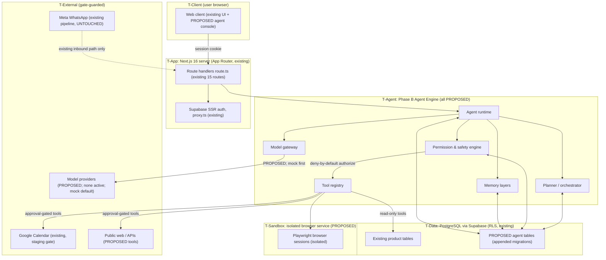
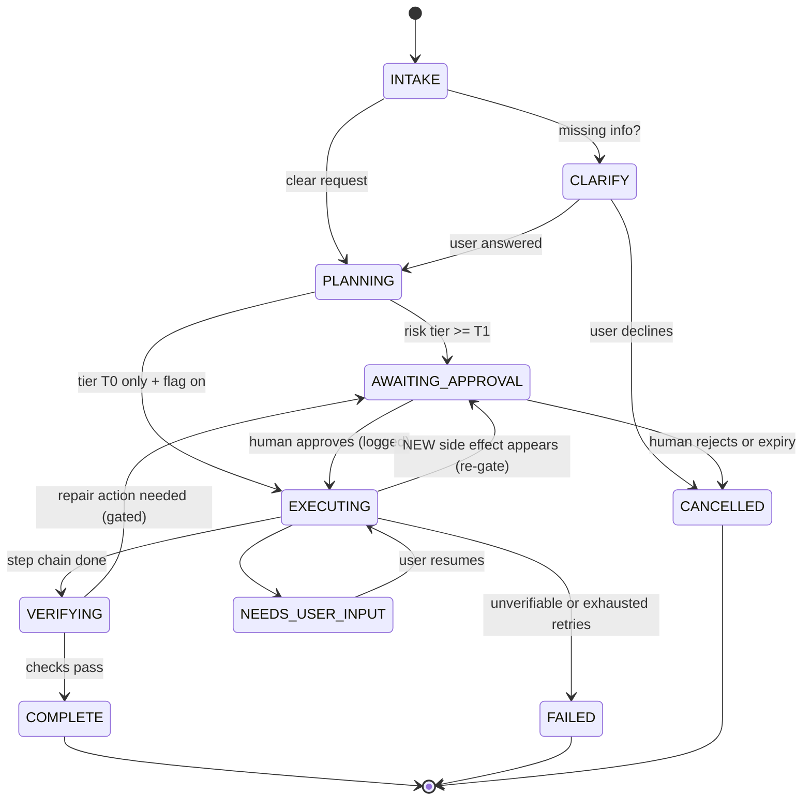

# DEXYBOR AI — PHASE B ARCHITECTURE BLUEPRINT (PROPOSED — IMPLEMENTATION NOT STARTED)

**Report:** PB-BLU-1 · **Date:** 2026-11-07
**Repo:** `C:\Users\ys725\OneDrive\Documents\Default Project\nexa` — DEXYBOR AI (legacy: Nexa) · HEAD `8c70be6` (`codex/appointment-integration-v1`, in sync)
**Next.js:** 16 (App Router; middleware is `proxy.ts` — confirmed against `node_modules/next/dist/docs/01-app/01-getting-started/16-proxy.md`)

> ## PROPOSED ONLY — NOT EXECUTED — NOT AUTHORIZATION
> This blueprint is a **design/preparation artifact**. It grants nothing. All designs marked below as `PROPOSED FOR PHASE B` are proposals for a future, separately owner-authorized implementation order. **Every item that alters code, dependencies, migrations, or infrastructure remains `STAGE F BLOCKED`;** the existing Stage F authorization hold (`OD-01 … STAGE F BLOCKED` — see `OD-01_AUTHORIZATION_EVIDENCE_INTAKE.md`) is preserved intact by the preparation of this document. No implementation was started, no code/config/dependency/migration file was touched, and nothing was deployed or provisioned while preparing this document.

**Evidence basis (all 2026-11-07):** `MERGE_HARDEN_ARCHITECTURE_REVIEW.md` §1/§3 (capability truth table, test-evidenced earlier today), fresh read-only globs of `app/**` & `lib/**`, `package.json`, `lib/ai/provider.ts`, Next-16 bundled docs. No fabrication: anything not visible in the repository is classified `NOT IMPLEMENTED` or `PROPOSED FOR PHASE B` and carries the explicit marker.

---

## 1. Executive architecture summary

DEXYBOR AI ("AI That Talks. AI That Acts.") will evolve from the existing **conversational-staging product** (WhatsApp staging drafts, sandbox calendar, review queues, mock-provider AI) into an **Agent Engine**:

- a **controlled, stateful agent runtime** that plans and executes scoped tasks;
- a **permission-first tool system**, where every tool is a versioned, schema-validated manifest with a declared risk class and audit trail;
- a **safety/permission engine** with deny-by-default tiers and human approval for any side-effecting or external action;
- a **layered memory** bounded by tenant isolation (RLS) and retention rules;
- a **provider-independent model gateway** (mock stays default; no foundation model is assumed to be owned);
- **isolated browser/computer-use environments** for future actuation capabilities.

The core design principle mirrors what the repository already has, verified fresh today: **fail-closed gates, feature-flagged mutations, human approval queues, least-privilege RLS, and append-only audit**. Nothing in this blueprint changes the proven WhatsApp pipeline, the production guard chain, or the Supabase migration discipline — those are trust anchors to build around, never through.

Deliverable Passenger (Mermaid) — top-level component & trust-boundary map (`PROPOSED FOR PHASE B` unless labelled):

Boundary rules (PROPOSED): the agent engine never reaches `T-External` except behind an `authorize()` decision from `PERM`; `SQ` holds no tenant credentials; `RT` code never reads raw secret values — a credential broker injects credentials at the tool-execution edge only.

---

## 2. DEXYBOR capability classification (10 product capabilities)

Classification legend — `EXISTING AND VERIFIED` (present + test evidence at HEAD 8c70be6, per MH-I §1 fresh matrix) · `PARTIALLY IMPLEMENTED` (real but bounded precursor exists) · `NOT IMPLEMENTED` (no repo evidence; MH-I §3) · `PROPOSED FOR PHASE B` (this blueprint's design, nothing executed):

| # | Capability (product vision) | Class today | Phase B mapping |
|---|---|---|---|
| 1 | Conversational AI assistant | `PARTIALLY IMPLEMENTED` — conversation persistence + kill switch/human takeover/opt-out (`lib/conversations.ts`, `lib/conversationSafety.ts`); AI drafts with deterministic mock provider (`lib/ai/mockProvider.ts`, `AI_PROVIDER=mock` default; openAI adapter present but offline/unkeyed) | Prosody untouched; agent conversational surface proposed in B1/B9 (additive engine, not modification) |
| 2 | Autonomous task planning & execution | `NOT IMPLEMENTED` (MH-I §3: no module, route, or runtime) | B4 planning/orchestration + B1 runtime — tier-limited, no unrestricted loops |
| 3 | Browser & computer-use | `NOT IMPLEMENTED` (no browser runtime) | B7 browser first; computer-use explicitly deferred behind separate owner decision |
| 4 | Web research & analysis | `NOT IMPLEMENTED` (no fetch/web tool) | B2 tool class; default read-only; approval-gated depending on class tier |
| 5 | Coding & dev assistance | `NOT IMPLEMENTED` | B2 sandboxed file/code tools (write = highest tier); repo itself is never a Phase-B runtime target for its own CI |
| 6 | Persistent task memory | `NOT IMPLEMENTED` — only "AI draft receives prior conversation turns as bounded recent memory" (test-evidenced) | B5 layered memory (sessions/tasks/user-approved persistent) |
| 7 | Tool & integration orchestration | `PARTIALLY IMPLEMENTED` — real product integrations exist (WhatsApp in/out pipeline; Google Calendar staging gate; sandbox calendar provider abstraction) but there is **no generic orchestrator/registry** | B2 registry unifies *future* tools; existing integrations stay as-is |
| 8 | Business workflow automation | `NOT IMPLEMENTED` | B9 controlled workflows only, approval-checkpointed |
| 9 | Human approval & permission mgmt | `PARTIALLY IMPLEMENTED` — approval queues & owner/admin guards exist for appointment reviews; generic agent permission engine absent | B3 generic permission/safety engine over the existing queue+RLS patterns |
| 10 | Execution verification & auditability | `PARTIALLY IMPLEMENTED` — `auditEvents.ts` least-privilege audit, webhook ledger dedupe, activation evidence guards (product features, per MH-I "must not be renamed into agent verification") | B8 agent-run verification/evidence + B2 per-invocation audit records |

**Anti-claim rule enforced in this document:** existing verified features (audit events, activation evidence, etc.) are trust anchors reused by the design; they are NOT agent capabilities and are not re-branded (per MH-I §3 note).

---

## 3. Existing repository compatibility (§4 inspection results)

### 3.1 Verified-present architecture (EXISTING AND VERIFIED)

| Area | Modules (freshly verified in this session) | Test evidence |
|---|---|---|
| App framework | Next.js 16 App Router, React 19, TypeScript 5, Tailwind 4, Turbopack build, 15 `route.ts` handlers, `proxy.ts` middleware | 40/40 routes fresh build PASS (`MERGE_HARDEN_VERIFICATION.md`); Next-16 bundled docs confirm `proxy.ts` guide |
| AuthN/AuthZ | Supabase SSR (`@supabase/ssr`), `lib/auth.ts`, `authRedirect.ts`, `internalAuth.ts`, `proxyRouting.ts` | `proxyRouting.test.ts`, `authRedirect.test.ts`, `internalAuth.test.ts`, `apiRouteSecurityContracts.test.ts`, `securityHeaders.test.ts` |
| Tenancy/isolation | `workspaces.ts` (creator-owned personal workspace), `teamMembers.ts`, RLS + RPC allow-list, `workspaceSafety.ts` | `workspaces.test.ts`, `teamMembers.test.ts`, `workspaceMigrations.test.ts` ("database API roles receive only the reviewed least-privilege allowlist") |
| Audit | `auditEvents.ts` (least-privilege, entity_type fail-closed), `webhookLedger.ts` dedupe | `auditEvents.test.ts`, `webhookLedger.test.ts` |
| WhatsApp (in) | `whatsappIngest.ts`, `whatsappChannels.ts`, `whatsappEvents.ts`, webhook ledger, processor isolation | `whatsappIngest.test.ts` + MH-G-W matrix (fresh PASS) |
| WhatsApp (out) | `lib/outbound/whatsappSender.ts` (flag-gated, `WHATSAPP_OUTBOUND_ENABLED=false`), `sessionWindow.ts` (24h), `validation.ts`, atomic claim `lib/server/outboundClaim.ts`, `failedSends` retry | MH-G-W triple-gate matrix six-section fresh PASS; 667-test suite includes them |
| Conversation safety | `conversations.ts`, `conversationSafety.ts` (kill switch, human takeover, unconditional opt-out, flagged-safety banner) | `conversations.test.ts` |
| AI (bounded) | `lib/ai/provider.ts` — `AIProvider { name; generateReply(AIReplyContext) }` (verbatim interface read today), `mockProvider.ts`, `openAIProvider.ts` (offline), `aiProviderStatus.ts`, `offlineSafetyEvals.ts`, `lib/server/aiProvider.ts` | `mockProvider.test.ts`, `openAIProvider.test.ts`, `aiProviderStatus.test.ts`, `offlineSafetyEvals.test.ts` |
| Integrations | Google Calendar: `lib/calendar/googleOAuth.ts`, `googleCalendarGate.ts` (staging-only gate, explicit calendar id, **no primary fallback**), `lib/server/googleCalendarStore.ts` (server-only tokens); Booking: `lib/booking/calendarProvider.ts` + `sandboxCalendarProvider.ts`, appointment reviews/decision/inbox with `reviewOriginGuard`/`reviewRouteGate`, `actionProposal.ts` | gate/store/schema/flow tests (all in 667-suite) |
| Employees domain | `aiEmployees.ts`, `employeeSandbox.ts`(+Contract), `employeeVersions.ts`, `employeeActivation.ts`, `employeeLifecycle.ts`, `deliveryFunnel.ts`, `cleanupTasks.ts` | respective tests (667-suite) |
| Knowledge | `knowledgeEntries.ts`, `knowledgeSources.ts` | respective tests |
| Release guards | `productionGuard.ts` + `next.config.ts` throw-on-unsafe-production, `deployPreflight.ts`, `trackedSecretGuard.ts`, `check:tracked-secrets`, `check:production-build`, `check:documented-count` | `productionGuard.test.ts`, `deployPreflight.test.ts`, guards 3/3 PASS fresh |
| Migrations | Monotonic Supabase migration chain; packaged SQL identical to sources (workspaceMigrations evidence) | `workspaceMigrations.test.ts` |
| Testing infra | 667-test suite, issue-reports 5/5, Playwright (dev dep), integration suites (disposable-DB — OD-02-gated), smoke scripts | fresh suite PASS today |

### 3.2 Reusable anchors (PROPOSED integration contract of Phase B: reuse these, don't fork them)

- **Auth/session + RLS tenancy** — every agent table inherits `workspace_id` RLS from day 1 (B1).
- **Approval queue + origin/route guard pattern** (`actions/appointmentReview*`, `reviewOriginGuard`, `reviewRouteGate`) — generalized into the agent approval engine (B3) without modifying the original.
- **Feature-flag + fail-closed gate pattern** (`WHATSAPP_OUTBOUND_ENABLED`, `googleCalendarGate`) — Phase B ships every mutating capability behind an explicit flag defaulting to disabled.
- **Atomic-claim queue pattern** (`outboundClaim` RPC) — reused for agent task leasing.
- **Audit + ledger append-only pattern** (auditEvents/webhookLedger) — extended with agent event classes.
- **Offline evals + status page** (`offlineSafetyEvals`, `aiProviderStatus`) — the promotion gate for any future real model.
- **Migration discipline** — Phase B only **appends new dated migrations**; existing chain files are frozen.
- **Test conventions + production guard chain** — acceptance criteria of every milestone embed them.

### 3.3 Must remain isolated (no-untouch list)

| Isolated component | Rule |
|---|---|
| WhatsApp webhook ingest path & outbound sender triple-gate | Phase B must not modify, wrap, or depend on it for agent behavior; any agent→WhatsApp send is Tier-5 separately authorized, via new additive path only, after existing gates re-verify unchanged |
| Supabase migration chain (existing files) | Append-only; existing files byte-frozen |
| AI draft pipeline (`conversations`/`aiEmployees`/draft sender) | Remains exactly as-is until B9's separately-owner-approved cutover decision |
| Production guard chain semantics | No Phase B flag may weaken `PRODUCTION_RELEASE_APPROVED` guard |
| Appointment review flow | Remains product-specific; generic engine is a sibling, not a replacement |

### 3.4 Missing capabilities (=> Phase B scope)

Agent runtime; planner/orchestrator; tool registry; permission engine; agent memory; model routing/routing-policy; browser runtime; computer-use; vector retrieval; worker/queue infra; rate limiting; i18n framework-level support; usage metering; residency topology; DR tooling.

---

## 4. Execution state machine (PROPOSED, B4) — no unrestricted loops

Terminal states only leave via human action; every transition is an append-only event row (`agent_events`). State held in PostgreSQL, not process memory — crash-resumable by design.

---

## 5. Subsystem designs (A–I)

### A. Agent Runtime (PROPOSED — B1)

| Concern | Design (PROPOSED) |
|---|---|
| Lifecycle | Task-level lifecycle per §4 FSM; worker-side step executor is stateless across invocations (all state in DB), enabling restart-safe recovery |
| Sessions & identity | `agent_sessions` row = (workspace_id, user_id, channel, model policy, created/last-active); agent identity = **explicit DB role** (least-privilege, per workspaceMigrations allow-list pattern) distinct from user roles |
| Task execution | Single `executeStep()` contract: load step → `authorize()` → invoke tool → persist result/evidence → emit event. Steps are idempotency-keyed to prevent double-execution after crash |
| Context handling | Deterministic context packer: persona/tenant facts + bounded recent turns (existing pattern) + task facts + step-relevant memory; hard token budget; large payloads passed by reference (artifact ids), never inline |
| Tool invocation | Only through registry (C). Direct provider/API calls from step code are a code-review-discipline violation, not an architectural option |
| Cancellation | Cooperative: DB `cancel_requested` flag checked between every step + long-tool polls; forced strip: lease expiry + watchdog reaper kills orphans; user-facing cancel wired to existing kill-switch semantics |
| Timeouts | Three clocks: per-step wall clock, per-tool class timeout, per-task overall deadline. All exceeded ⇒ FAILED with reason + partial evidence; nothing silently runs on |
| Retry | Per-tool-class policy (`retryable` flag + max attempts + exponential backoff + jitter); permission errors are never retried; identical-tier replan requires user consent |
| Concurrency | Per-workspace concurrent task cap (default 1–2), global cap; lease-based claim (adopt `outboundClaim`-style atomic RPC pattern) + heartbeat; watchdog reclaims dead leases |

### B. Planning & orchestration (PROPOSED — B4)

- **Request interpretation:** deterministic intake schema + clarifying-questions generator; ambiguous ⇒ CLARIFY, never assumed.
- **Decomposition:** draft plan = ordered step list; each step declares tool name, args sketch, expected evidence, risk tier, dependency ids (DAG).
- **Plan visibility:** the user always sees the plan before T1+ execution; plan edits by the user create a new plan version (old one immutable).
- **Loop guards (hard caps, not tunables-at-agent-will):** max steps per task (default 25), max replans (default 2, each needs either user consent or a same-tool bounded retry), max wall-clock, max spend. Exceeding any cap ⇒ terminal NEEDS_USER_INPUT/FAILED, never an implicit continue.
- **Step dependencies:** DAG enforced by scheduler (a step runs only when all predecessors SUCCEEDED/SKIPPED-approved).
- **Progress tracking:** per-step rows with status, attempt count, evidence links; console polls/sse (API contracts §7).
- **Recovery after failure:** crash-safe resume from last completed step via persisted FSM; poisoned step ⇒ human review queue, not auto-retry; partial success is preserved (never discarded silently).
- **Human approval checkpoints:** every T2+ action regenerates a checkpoint (§4 `EXECUTING → AWAITING_APPROVAL` on NEW side effect); approvals are workspace-scoped, expiring, and audit-noted (reusing review-inbox pattern).

### C. Tool system (PROPOSED — B2)

Registry manifest fields (each tool, versioned semver):

| Field | Meaning |
|---|---|
| `name`, `version` | identity + immutability (same version = same behavior; allow-list per tenant) |
| `capability_class` | `READ_LOCAL` / `READ_WEB` / `WRITE_LOCAL` / `WRITE_EXTERNAL` / `MESSAGING_SEND` / `FILE_SYSTEM` / `CODE_EXEC` / `BROWSER_DRIVE` |
| `input_schema`, `output_schema` | strict validation; unknown fields rejected; strings size-bounded |
| `required_tier` | permission tier T0–T5 (§ D) |
| `timeout_class` | fast (5 s) / standard (30 s) / long (120 s) |
| `side_effect` | none / external-visible / financial / destructive |
| `reversible` | bool + inverse-tool reference if any |
| `audit` | always-on: args-hash, result-class, duration, cost-delta |

Future tool families the registry must be able to hold: **browser drive** (G), **computer use** (deferred), **web research** (fetch/search citation-bound), **file operations** (workspace-scoped object storage only), **coding** (sandboxed workspace repo tools), **API connectors** (tenant-configured credentials via broker), **business workflows** (B9-composed). Error taxonomy: `VALIDATION / PERMISSION / RATE_LIMIT / TIMEOUT / UPSTREAM / INTERNAL` with `retryable` classification; every recovery/paused/error verdict lands as an event + optionally an inbox item.

### D. Permission & safety engine (PROPOSED — B3)

Tier ladder (deny-by-default):

| Tier | Class | Confirmation policy |
|---|---|---|
| T0 | read within own workspace | auto (flag-gated feature) |
| T1 | write within own workspace (non-external) | once per task, user-visible plan covers it |
| T2 | external API read/write with tenant credentials | per-action approval |
| T3 | external messaging/actions visible to third parties | per-action approval + full transcript evidence |
| T4 | browser drive sessions (interaction with sites) | session start approval + per-sensitive-action approval (submit/upload/download) |
| T5 | settings, secrets, integrations config, any send through the WhatsApp channel | owner-only, separately written authorization; never agent-granted |

Risk classification = `data_sensitivity × side_effect × blast_radius` matrix scored per step; score elevates tier, never lowers it.

- **User authorization:** inherits existing session+RLS; permissions attach to (workspace, tier, tool family) with expiry & scope notes; all changes through owner/admin UI/API (audited).
- **Self-grant prohibition — enforcement at three layers:** (1) DB: the agent's DB role has **no INSERT/UPDATE on permission/approval tables** (least-privilege allowlist pattern, tested like workspaceMigrations); (2) code: `authorize()` is the only PEP and reads grants read-only; (3) audit: any permission-table mutation outside the owner-API discriminates as a security alarm.
- **Secret isolation:** agent runtime processes never receive plaintext secret values; credentials live in server-only stores (pattern: `googleCalendarStore.ts`); a credential broker serializes into tool-call envelopes at the execution edge only; log redaction enforced by `trackedSecretGuard`-style checks.
- **Sandboxing:** v1 sandbox = object-storage workspace root + allow-listed domains/hosts; no shell, no arbitrary process exec; browser isolated per §G.
- **Emergency controls:** per-task cancel, per-workspace pause (agent engine flag), tenant kill switch (semantics reused from conversationSafety), global disable flag — all fail-closed.
- **Policy enforcement point:** single `authorize(toolCall) → ALLOW/CHALLENGE/DENY` decision; decisions cached only per-step and logged.

### E. Memory architecture (PROPOSED — B5)

| Layer | Scope | Lifetime | Control |
|---|---|---|---|
| M0 conversation context | bounded recent turns (existing) | within conversation | existing retention; untouched |
| M1 session scratchpad | task-scoped working state | task TTL | owner of workspace |
| M2 task memory | structured step outputs, artifacts, evidence links | task retention window | workspace-scoped |
| M3 user-approved persistent memory | explicit facts the user chose to keep | until user edits/deletes | explicit consent + audit + user-visible list/edit/delete |
| M4 knowledge retrieval | existing `knowledge_entries` (+ PROPOSED embeddings) | content-managed | tenant-scoped |
| M5 external data references | URLs/IDs only (never bulk-fetched copies without retention policy) | revalidation window | workspace |

Privacy/retention: all layers RLS by `workspace_id`; deletion APIs cascade M1–M3/M4 for a tenant; retention windows are owner-decided defaults (open question §12); PII-minimization scan before M3 persistence; **no cross-tenant read is representable** (deny-by-default RLS tested with adversarial fixtures).

### F. Model & inference layer (PROPOSED — B6)

- **Provider independence:** evolve `AIProvider` (existing interface, read verbatim today) toward a richer internal `ChatModel` contract (message list in → text/structured/tool-calls/usage out). The existing draft pipeline keeps its current interface untouched; the new contract is additive.
- **Adapter set:** `mock` (default, exists), hosted-commercial adapter (`openAIProvider` exists but **offline**; activation = owner decision), open-weight HTTP adapter (PROPOSED), self-hosted adapter (PROPOSED), specialist (embeddings; PROPOSED). **DEXYBOR does not own a foundation model — assumed and designed for.**
- **Selection & fallback:** routing policy table per task class (planning vs chat vs extraction vs embedding) with cost/latency classes; deterministic fallback ladder (e.g., primary → cheaper secondary → mock-with-degraded-limitations) — fallback to `mock` is always safe-terminal, never silently "acts smart".
- **Cost & latency:** every invocation records model, tokens in/out, cost estimate, duration into `agent_usage_ledger` (tenant-scoped); per-task/per-workspace budget ceiling with a circuit breaker → task-level NEEDS_USER_INPUT, not runaway spend.
- **Evaluation:** offline safety evals remain the *minimum* gate (existing suite); any newly enabled provider requires an owner-approved eval pack result before policy table entry flips.
- **Observability:** status page extension + Sentry monitoring (already wired per repo) for adapter errors; provider health probes.

### G. Browser & computer-use (PROPOSED — B7; computer-use deferred)

- **Isolation model:** browser runs in a **separate service process** (Playwright-based; dev-dependency exists for tests — runtime browsers are a PROPOSED owner decision), ideally later containerized; one ephemeral profile per task-session; zero reuse of personal/user cookies or credentials; all state stored only in the task sandbox.
- **Navigation:** default-deny network allow-list per session (tenant + task policy); screenshot/DOM-inspection-first interaction; typed navigation is T4-gated.
- **UI interaction:** read-only inspection fine; any *submitting* action (form posts, button that triggers side effects, upload/download) requires per-action approval and produces before/after evidence pairs.
- **Downloads/uploads:** captured into sandbox object-storage only; uploaded material must originate from the tenant's approved staging area; size caps.
- **Domain restriction:** session policy = (deny by default) + tenant allow-list + crystal-clear per-action display of the exact target before approval.
- **Session hygiene:** hard session TTL; teardown wipes ephemeral state; compromise-of-session contingency = instant kill switch + evidence retention.
- **Computer-use (full desktop control):** **explicitly deferred** — architecture reserves the tool-manifest family (§C) but B7 ships no computer-use capability; enabling it later is a separate owner decision with its own authorization.

### H. Data & infrastructure (PROPOSED — B1/B2 foundations; nothing provisioned now)

| Need | Design (PROPOSED) | Anchor |
|---|---|---|
| PostgreSQL | Supabase Postgres (existing) — agent tables appended via fresh migrations with RLS | existing chain discipline |
| Vector retrieval | `pgvector` extension PROPOSED for M4 (owner decision) | open question §12 |
| Object storage | Supabase storage buckets (workspace-scoped prefixes) for artifacts/screenshots/files | — |
| Queue | DB-backed `agent_tasks` queue + atomic claim RPC (pattern proven by `outboundClaim`) + lease/heartbeat | reuse pattern |
| Background workers | long-running Node worker process consuming the queue (deployment model = owner decision; local dev = npm script) | — |
| Event logging | `agent_events` append-only (+ existing audit_events for privileged ops) | audit disciplines |
| AuthN | existing Supabase session cookies + route guards; no new identity system | — |
| Rate limiting | middleware token-bucket per workspace/user on agent routes + queue-order fairness | — |
| Monitoring | Sentry (existing) + agent event dashboards (PROPOSED) | existing instrumentation |

### I. Global scalability (PROPOSED)

- **Multitenancy:** existing creator-owned workspace model; agent tables inherit isolation; per-tenant policy rows (tier defaults, budgets, retention).
- **Data residency:** architecture leaves room for region-partitioning via a tenant→region policy table; actual deployment topology is a **future owner decision** (no provisioning now).
- **Internationalization:** language preference per user/workspace; agent outputs and approval-UI copy localized; agent content-generation respects locale & time-zone (UTC storage + display TZ).
- **Time zones & scheduling:** all timestamps UTC + tz-aware formatting; scheduled tasks store wall-clock intent with origin tz.
- **Usage metering & billing boundary:** complete internal metering via `agent_usage_ledger` rollups; **no external billing integration in Phase B** (boundary documented).
- **Reliability/DR:** append-only + idempotent execution make restore-to-point safe; backup/PITR strategy and restore-drill runbook documented as PROPOSED operations for owner approval; no infrastructure touched now.

---

## 6. Permission model summary (trust boundaries + tiers)

| Boundary | Who/what | Trusts | Enforcement |
|---|---|---|---|
| T-Client | user browser | session token only | RLS + server validation |
| T-App | Next.js server | DB via RLS; no phase-B secrets in client bundles | route handlers + origin/route guards |
| T-Agent | agent runtime + planner + registry | dedicated DB role; **no** plaintext secrets | `authorize()` PEP; caps; audit |
| T-Sandbox | browser service | ephemeral, domain allow-list, no tenant credentials | session policies; watchdog |
| T-Data | PostgreSQL | RLS per workspace + least-privilege roles | migration-tested allow-lists |
| T-External | Meta/Google/model providers/public web | never implicit | tier gates T2–T5 + approval evidence |

---

## 7. Database & event model (PROPOSED — appended by fresh migrations only)

Core tables (names indicative; final names/settle at implementation under owner authorization):

- `agent_sessions(id, workspace_id, user_id, status, model_policy, created_at, last_active_at)`
- `agent_tasks(id, session_id, workspace_id, goal, plan_version, state_family, cancel_requested, deadline_at, budget_cap, created_by)`
- `agent_task_steps(id, task_id, seq, tool_name, tool_version, args_hash, risk_tier, status, attempts, lease_expires_at, evidence_ref)`
- `tool_invocations(id, step_id, workspace_id, tool, version, tier, outcome_class, duration_ms, cost_delta, audit jsonb)`
- `agent_approvals(id, workspace_id, task_id, step_id, tier, requested_at, decided_by, decision, expiry_at)` — mirrors review-inbox pattern
- `agent_memory_items(id, workspace_id, layer, payload_ref, consent_record, expires_at, deleted_at)` — M1/M3 rows
- `agent_usage_ledger(id, workspace_id, task_id, model, tokens_in/out, cost_estimate, created_at)`
- `agent_events(task_id, seq, type, payload jsonb, at)` — append-only FSM transitions

Event flow: domain events land in `agent_events` (state transitions, approvals requested/decided, tool outcomes, cancellations) → SSE/API consumers read through authorized views; privileged operations additionally write `audit_events` (existing table, least-privilege fail-closed). All tables RLS-gated by `workspace_id`; the agent DB role's grants = read/write only on agent tables + read on referenced business tables, per allow-list test discipline.

---

## 8. API contracts (PROPOSED; additive routes only)

| Route (proposed) | Purpose | Tier/Policy |
|---|---|---|
| `POST /api/agent/tasks` | create task (goal, context refs) → returns task id + draft plan | user session; rate-limited; flag-gated |
| `GET /api/agent/tasks/:id` | task state + steps + progress | user session (own workspace) |
| `GET /api/agent/tasks/:id/events` | SSE stream of `agent_events` | authorized view; per-connection budget |
| `POST /api/agent/tasks/:id/approve` / `..:decide` | human approval decision (mirrors appointment-review contract style) | owner/admin; expiry enforced; audit-noted |
| `POST /api/agent/tasks/:id/cancel` | cooperative cancel | user session; logged |
| `GET /api/agent/tasks/:id/plan` | current plan + versions | user session |
| `POST /api/agent/memory` / `GET ..` / `DELETE /:id` | M3 persistent memory CRUD | user session; consent+audit wired |

Contract invariants: every mutating route = same security posture as existing (`apiRouteSecurityContracts` discipline); deterministic error envelopes; idempotency keys on POST; schema-validated bodies; no raw file paths or secrets in responses.

---

## 9. Security & threat model (§5) — mitigations + verification tests

| # | Threat | Mitigations (design) | Verification tests (proposed) |
|---|---|---|---|
| 1 | Prompt injection (content-as-instruction) | data/instruction origin labeling; tool args never taken from uncontrolled text without schema; "code from data" prohibited; context packer tags provenance; injection-eval suite before any real model | adversarial fixture corpus runs through planner+context packer; eval asserts no tool-call fabricated from injected text |
| 2 | Malicious websites (browser reads) | default-deny allow-list; read-first interaction; submission/upload/download approvals; no credential autofill; screenshot evidence | fake-phish fixture domain test: drive attempt → blocked or approval-required + audit row |
| 3 | Tool abuse (args outside spirit) | strict schemas; unknown-field rejection; size/depth bounds; per-tool rate budgets | fuzz inputs against manifests; assert only VALIDATION/PERMISSION outcomes, no execution |
| 4 | Unauthorized data access | RLS on every agent table; agent role allow-list; PEP single choke point; row-owner checks | adversarial RLS fixtures (other workspace ids) return zero rows + allow-list grant test |
| 5 | Cross-tenant leakage | deny-by-default RLS; workspace-scoped prefixes in storage; SSE authorized views | cross-tenant probe tests incl. memory + events routes |
| 6 | Secret exposure | runtime never receives plaintext; broker injects at edge; redaction checks; tracked-secret guard | log-redaction fixture tests + grant matrix test proving agent role lacks secret-table access |
| 7 | Unsafe file operations | workspace-root sandbox; extension/size caps; no exec bit; path-normalization | traversal (`../`) corpus n walking → all rejected; oversize rejected |
| 8 | Browser session compromise | ephemeral profiles; no persistent auth in sandbox; instant kill switch; evidence retention | session reuse test = clean profile each run; kill-switch drill test |
| 9 | Infinite agent loops | hard caps (steps/replans/wall-clock/spend); terminal states not escapable by agent; watchdog | synthetic always-failing-tool task; assert it terminates within caps with FAILED/NEEDS_USER_INPUT |
| 10 | Excessive model/tool spend | budgets per task/workspace; circuit breaker; ledger totals; model downshift instead of runaway | budget-cap unit tests; breaker opens market at threshold and routes to mock/terminal |
| 11 | Unauthorized external actions (send/spend/modify) | tier ladder + per-action approvals; WhatsApp channel remains Tier-5 + untouched triple-gate; approval expiry; audit | approval-required tests for T2+; attempt-without-approval → DENY + audit; WhatsApp gate regression suite stays green=focused |

---

## 10. Technology decisions with alternatives (PROPOSED; no dependency/service changes without owner authorization)

| Decision | Chosen (proposal) | Alternatives considered | Rationale |
|---|---|---|---|
| Task queue | Postgres DB-backed + atomic claim RPC | Redis/RabbitMQ/Kafka; Supabase cron | reuses proven outboundClaim pattern; one less moving/hazardous system; RLS co-located |
| Vector store | pgvector extension | external vector DB (Pinecone/Weaviate); no embeddings initially | tenant RLS consistency; owner decision pending |
| Worker runtime | separate Node worker process (stateless step executor) | serverless functions; in-app timers | long tasks + leases; deployment model owner-decided |
| Browser engine | Playwright service process | container-first (later), CDP direct | dev-dependency familiarity; containerization as hardening step |
| Model gateway | internal adapter layer over `AIProvider`-lineage | off-the-shelf gateway products | small surface, mock-first, no new deps without approval |
| Schema validation | hand-rolled strict typed schemas (current repo pattern uses plain TS contracts) | add zod-class library (NOT in current deps) | zero-new-dependencies default; owner may approve a library later |
| Secrets | existing env + server-only stores | external vault | matches current verified pattern; vault = future option |
| Rate limiting | middleware bucket + queue fairness | external gateway | self-contained, testable offline |
| i18n | lightweight tenant/user locale registry | full i18n framework | Phase-B keeps surface small; framework optional later |
| IaC/provisioning | none (no deploy) | future IaC | this blueprint provisions nothing (per prompt) |

---

## 11. Phase B roadmap — B1..B9 (PROPOSED; each milestone independently testable; nothing started)

> Cross-cutting acceptance for every milestone: `npm run check` green (typecheck, lint, tests, guards, build); new tests added; RLS allow-list tests extended; no new dependencies without owner authorization; migration append-only; flags default off; no production connectivity.

### B1 — Agent Runtime Foundation
- **Objective:** minimal runtime + sessions/tasks/FSM persistence + cooperative cancel + lease/claim + watchdog, mock-executed steps only.
- **Dependencies:** none beyond current HEAD (after Stage F if repo work involves branches; pure-local otherwise). Additive migrations.
- **Deliverables:** agent tables + append migrations; runtime module; lease RPC; cancel/timeout semantics; SSE events skeleton; console (read-only list/status).
- **Acceptance:** FSM transitions complete offline; crash-recovery test resumes at last step; deadlines produce FAILED-with-evidence; per-workspace cap honored.
- **Security tests:** agent-role grant matrix; RLS cross-tenant fixtures; kill-switch drill; cancel race tests.
- **Failure conditions:** fail open on any gate; events durable; queue idempotent.
- **Rollback strategy:** flags off + engine dormant (zero behavioral surface); tables additive.

### B2 — Tool Registry & Execution Contracts
- **Objective:** manifest format, registry load, schema validation, per-class timeout/retry, audit-per-invocation; first tool families: file-ops (workspace storage), web-research read-only, calendar-read via existing gate adapter.
- **Dependencies:** B1.
- **Deliverables:** registry + manifests; invocation audit rows; validation/errors taxonomy; docs.
- **Acceptance:** every invocable tool has strict schema; unknown fields rejected; audit rows complete; timeouts per class honored.
- **Security tests:** fuzz suite; audit completeness; "no direct API call" static boundary test.
- **Failure conditions:** registry hard-fails closed if manifest invalid (no best-effort exec).
- **Rollback strategy:** registry feature-flag off.

### B3 — Permission & Safety Engine
- **Objective:** `authorize()` PEP, tier ladder, approval engine (generalized, not modifying existing queues), credential broker, workspace pause/kill switch, self-grant prohibition enforcement.
- **Dependencies:** B1, B2.
- **Deliverables:** policy tables + grants API (owner/admin only); approval inbox (agent-style); broker; alarms.
- **Acceptance:** T2+ impossible without logged approval; agent role cannot mutate permission tables (tested); approvals expire; secrets never in logs.
- **Security tests:** self-grant attempt → DB-denied + audit alarm; approval-expiry race; redaction corpus.
- **Failure conditions:** broker alive; PEP alive; fail closed on missing grant.
- **Rollback strategy:** tier-level flags; engine can be reduced to "deny all external" instantly.

### B4 — Planning & Orchestration
- **Objective:** intake/clarify, deterministic plan under cap, context packer, step DAG scheduling, approval checkpoints in-flight, recovery.
- **Dependencies:** B3.
- **Deliverables:** planner module; plan versioning services; orchestration loop with all §4 caps; recovery tests.
- **Acceptance:** no unrestricted loop possible (cap tests); plan visible pre-execution for T1+; replans bounded and consented.
- **Security tests:** injection-eval corpus; cap-breach suite; approval re-gate on new side effect.
- **Failure conditions:** unfinished goals land at NEEDS_USER_INPUT, not silent discard.
- **Rollback strategy:** planning flag off → runtime only executes single approved steps.

### B5 — Memory System
- **Objective:** layers M1–M5 with retention/deletion/access controls; M3 consent flow; references-only default for M5.
- **Dependencies:** B1 (tables), B4 (context integration).
- **Deliverables:** memory services + migration; consent UI/contract pack; deletion cascade.
- **Acceptance:** retention honored; deletion cascades; consent records auditable; no unbounded context growth.
- **Security tests:** cross-tenant probes; PII-scan fixtures; consent missing ⇒ not stored.
- **Failure conditions:** injection via memory reads (fixtures).
- **Rollback strategy:** layers independently disable; M3 off ⇒ context collapses to M0 (existing).

### B6 — Model & Inference Abstraction
- **Objective:** internal ChatModel contract + adapters (mock active; hosted adapter kept offline until owner keys/decisions), routing policy, budgets/ledger, eval promotion gate.
- **Dependencies:** B1; overlaps fine with B4/B5 as consumers.
- **Deliverables:** contract + adapters + policy table + usage ledger + circuit breaker.
- **Acceptance:** fallback ladder deterministic; every invocation metered; breaker tests pass; mock remains default and safe.
- **Security tests:** adapter fuzz; budget-breach; provider-retry storm guard.
- **Failure conditions:** provider outage → deterministic downgrade, no data loss.
- **Rollback strategy:** policy table reverts to mock-only instantly.

### B7 — Browser & Computer-Use Integration
- **Objective:** isolated Playwright service + session policies + evidence screenshots + approval-gated interactions; download/upload controls.
- **Dependencies:** B3 (T4), B2 (browser tool manifests); owner decisions: runtime browsers, hosting model.
- **Deliverables:** browser service; domain/session policy engine; before/after evidence capture; approvals flow.
- **Acceptance:** all side-effecting site actions approval-gated with evidence; allow-list enforced; session teardown wipes state; full audit.
- **Security tests:** phish-domain block; profile-cleanliness test; submit-approval-required matrix; kill-switch drill.
- **Failure conditions:** fail closed without approval; no residual session state.
- **Rollback strategy:** service flag off; manifests detached; tools unregistered.

### B8 — Evaluation, Observability & Reliability
- **Objective:** agent eval suite (offline + scripted scenarios), event dashboards, watchdogs, budget analytics; DR runbook text.
- **Dependencies:** B1–B7 artifacts.
- **Deliverables:** eval harness + scenario packs; evidence/checks for VERIFYING state; observability endpoints.
- **Acceptance:** every milestone's security test pack re-runs green; dashboards show tier/cost/evidence aggregates; restore-drill runbook reviewed.
- **Security tests:** full threat-model matrix (§9) executed as automation.
- **Failure conditions:** circuit breaker opens on budget breach; no tenant data leaves its boundary.
- **Rollback strategy:** observability is passive; eval harness offline.

### B9 — Controlled Product Integration
- **Objective:** narrow user-facing agent surface (console + task console) with flags; strictly no modification of the draft/WA pipeline; explicit cutover decisions owner-authored.
- **Dependencies:** B1–B8 + **explicit owner authorization + Stage F resolution**.
- **Deliverables:** console UI; flag-controlled onboarding; documentation + operator runbook.
- **Acceptance:** all upstream suites + full §9 matrix green; product-level kill switch verified; `WHATSAPP_OUTBOUND_ENABLED` remains `false` everywhere.
- **Security tests:** e2e approval-cycle with sandbox identity; abuse-of-console negative tests; release-gate suite (production guard unchanged).
- **Failure conditions:** any existing pipeline test altered = fail.
- **Rollback strategy:** console flag off; integration branch remnants deletable via owner-approved cleanup only.

---

## 12. Open questions & owner decisions (blocking nothing today; gates at their milestones)

| # | Decision | Why needed | Effects |
|---|---|---|---|
| OD-B1 | Prompt/agent library (e.g., a schema lib) allowed or zero-new-deps contract typing | B2 | affects dependency authorization |
| OD-B2 | pgvector vs no-embeddings-for-now | B5 | storage/migration append |
| OD-B3 | Worker process hosting model (own process vs serverless/cron) | B1 deploy-time | infrastructure decision only |
| OD-B4 | Playwright runtime browsers + browser service hosting (local/CI/container) | B7 | T4 capability enabling |
| OD-B5 | Retention windows per memory layer + event archive policy | B5/B8 | compliance/privacy defaults |
| OD-B6 | Model provider activation order + keys/procurement (none active; mock default) | B6 | provider table reality |
| OD-B7 | Budget defaults (per task/workspace ceiling values) | B6/B8 | usage metering |
| OD-B8 | Residency topology / tenant→region policy (deferred) | I | future deployment shape |
| OD-B9 | Billing integration boundary (none in Phase B) | I | metering-only boundary |
| OD-B10 | Computer-use deferral confirmation (stay deferred) | G | scope boundary |
| OD-B11 | Any agent→WhatsApp send pathway (Tier-5; separate authorization, additive, post-existing-gates) | D | customer-visible messaging |
| OD-B12 | Phase B workstream sequencing vs Stage F (parallel-token or after Stage F) | all | repo mutation schedule |

## 13. Standing dependencies on Stage F (unchanged)

1. Any code/deps/migration edits to implement anything above = repository mutations ⇒ require **OD-01 signed authorization + separate explicit instruction + formal verification** (per `OD-01_AUTHORIZATION_EVIDENCE_INTAKE.md`) — Stage F remains BLOCKED.
2. Existing uncommitted work (+248/−44, 12 modified + 14 untracked preserved) must reconcile first (MH-D S1 plan) — Phase B builds on the reconciled base, never beside it.
3. Dependency floors (MH-E proposals) are the precondition for a trustworthy base under Phase B code; **no** `npm audit fix`.
4. Production release stays NO-GO; Phase B owns no release path of its own.

## 14. Documentation-safety statement (§7 pre-condition)

This document is a **new, additive, untracked documentation file** (`docs/DEXYBOR_PHASE_B_ARCHITECTURE_BLUEPRINT.md`); it was prepared under the same documentation-only convention established and used in every prior authorized session (12+ report docs already created; no existing file overwritten; working tree otherwise untouched). It modifies no code, config, dependency, lockfile, migration, env, or Git object; the Stage F authorization hold and all safety rules remain fully in force.

---

**Status: `DEXYBOR PHASE B BLUEPRINT PREPARED — IMPLEMENTATION NOT STARTED — STAGE F AUTHORIZATION HOLD PRESERVED`**

*Marks legend: without a class marker, everything in §4–§11 is `PROPOSED FOR PHASE B`. Facts sourced "existing/verified" carry MH-I fresh-test evidence or were re-verified today by direct repository inspection under the read-only operating mode.*
